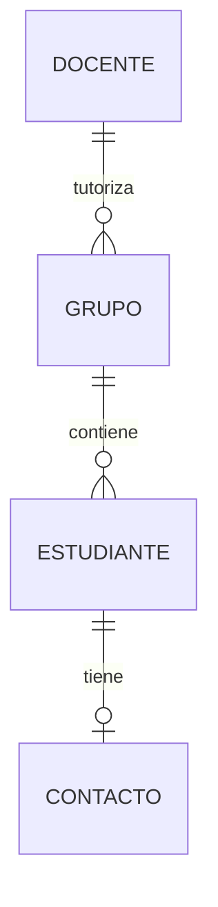

# Modelo de datos CampusHub — Parte B

## Información almacenada en PostgreSQL

Grupos, estudiantes y fichas de contacto tienen una estructura estable y relaciones que deben ser válidas. Por eso se almacenan en PostgreSQL mediante entidades JPA, claves primarias y claves foráneas.

## Estructuras y relaciones

- **Grupo:** tiene un identificador, nombre, nivel y un docente tutor. La columna `tutor_docente_id` referencia un docente existente.
- **Estudiante:** tiene nombre, apellidos, email, fecha de nacimiento y un grupo. `grupo_id` referencia el grupo al que pertenece.
- **Contacto:** guarda el tutor legal, teléfono, email, autorización y fecha de autorización. Su clave primaria también es clave foránea hacia `estudiante.id`; así cada estudiante puede tener como máximo una ficha y no puede haber fichas sin estudiante.

## Restricciones e índices

- El email del estudiante es obligatorio y único. El servicio lo normaliza a minúsculas y PostgreSQL aplica una restricción `UNIQUE`.
- Grupo y docente tutor son referencias obligatorias.
- `grupo_id` identifica el grupo obligatorio del estudiante.
- `contacto.estudiante_id` es clave primaria y foránea, lo que impide duplicar la ficha.
- Los campos obligatorios y las longitudes máximas se declaran en las entidades JPA mediante `@Column`.
- El índice `idx_estudiante_grupo` facilita consultar los estudiantes de un grupo. La clave primaria y la restricción única de email también cuentan con sus índices.
- El servicio valida que la fecha de nacimiento sea anterior a hoy. Además, un trigger de PostgreSQL rechaza fechas actuales o futuras incluso cuando se intenta insertar directamente en la base de datos.

## Justificación

Estos datos se guardan en PostgreSQL porque tienen relaciones claras y necesitan restricciones de integridad, como emails únicos y referencias a grupos o docentes existentes. La ficha de contacto se mantiene en una tabla separada porque puede no existir todavía, pero cuando existe pertenece a un único estudiante.

Los registros de seguimiento de las actividades tienen estructuras variables y corresponden a otra parte del diseño; no se duplican en estas tablas.