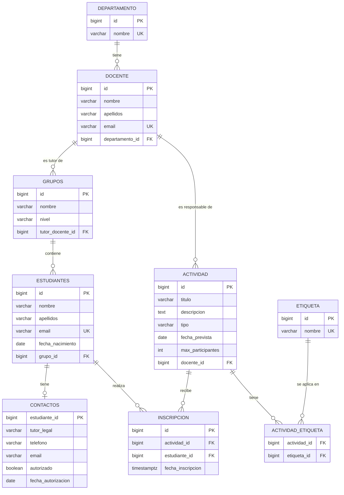

# Modelo de datos — CampusHub

> Diseño final implementado. Los cambios respecto al diseño inicial están al final y en `docs/decisiones-tecnicas.md`. Hay detalle adicional de grupos, estudiantes y contacto en `docs/modelo-datos-parte-b.md`.

## 1. Reparto entre PostgreSQL y MongoDB

| Motor | Qué guarda | Por qué |
|---|---|---|
| PostgreSQL | Departamentos, docentes, grupos, estudiantes, fichas de contacto, actividades, inscripciones y etiquetas | Datos con estructura fija, relaciones entre ellos y reglas que la base de datos debe imponer (unicidad, claves foráneas, aforo). |
| MongoDB | Seguimientos de las actividades | Cada tipo de actividad guarda datos distintos y pueden aparecer tipos nuevos sin cambiar el esquema. |

## 2. Diagrama relacional (PostgreSQL)



En `contactos` la clave primaria es también clave foránea a `estudiantes`.

## 3. Restricciones e índices

| Tabla | Restricciones principales |
|---|---|
| `departamento` | `nombre` único, obligatorio, máx. 100 |
| `docente` | `email` único, máx. 255; departamento obligatorio; índice `idx_docente_departamento` |
| `grupos` | nombre (100) y nivel (50) obligatorios; tutor docente obligatorio |
| `estudiantes` | `email` único (`uk_estudiante_email`); grupo obligatorio; `CHECK` y trigger de fecha de nacimiento anterior a hoy; índice `idx_estudiante_grupo` |
| `contactos` | clave primaria = clave foránea al estudiante (una ficha como máximo, no existe sin estudiante) |
| `actividad` | `CHECK (max_participantes > 0)`; `descripcion` de tipo `TEXT`; docente obligatorio; tipo guardado como texto; índice `idx_actividad_docente` |
| `inscripcion` | pareja (`actividad_id`, `estudiante_id`) única (`uk_inscripcion_actividad_estudiante`); fecha obligatoria; índice `idx_inscripcion_estudiante` |
| `etiqueta` | `nombre` único, máx. 50 |
| `actividad_etiqueta` | clave primaria compuesta (`actividad_id`, `etiqueta_id`); índice por `etiqueta_id` |

### Borrado

La API no ofrece borrado. Las claves foráneas no tienen cascada, así que la base de datos impide
borrar un registro que otros referencian (por ejemplo, un docente con actividades).

## 4. MongoDB: colección `seguimientos`

```json
{
  "_id": "ObjectId",
  "actividadId": 10,
  "tipo": "VISITA",
  "datos": { "empresa": "Acme", "observaciones": ["aprendizaje", "visita"] },
  "creadoEn": "2026-11-12T12:00:00Z"
}
```

- `datos` es un objeto libre, guardado tal cual llega.
- Índice sobre (`actividadId`, `creadoEn`).
- Validación mínima (`$jsonSchema`): `actividadId`, `tipo` y `creadoEn` obligatorios y con su tipo;
  `datos` de tipo objeto sin fijar sus campos. Se aplica al arrancar (`MongoInicializador`).

## 5. Riesgo de usar dos motores

Ver `docs/decisiones-tecnicas.md`, apartado 4.

## 6. Decisiones que cambiaron

Ver `docs/decisiones-tecnicas.md`, apartado 6.
