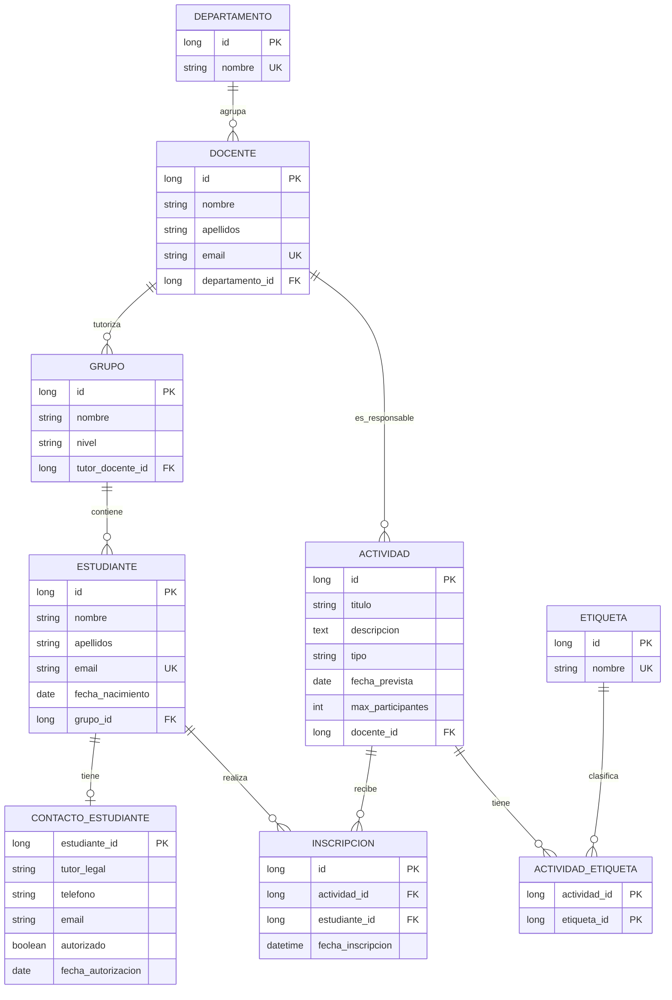

# Modelo de datos

## 1. Diagrama relacional (PostgreSQL)



La clave primaria de `contacto_estudiante` (`estudiante_id`) es a la vez clave foránea al estudiante
(`@MapsId`). Así un estudiante solo puede tener una ficha, y la ficha no puede existir sin él.

## 2. Longitudes y tipos

| Campo | Tipo | Por qué |
|---|---|---|
| nombre (persona) | `varchar(80)` | Cubre nombres compuestos |
| apellidos | `varchar(120)` | Dos apellidos, a veces largos |
| email | `varchar(254)` | Longitud máxima de una dirección de correo |
| nombre de departamento y de etiqueta | `varchar(100)` | Nombres cortos |
| nombre del grupo | `varchar(100)` | Nombre corto |
| nivel del grupo | `varchar(50)` | Valores como «2 DAM» |
| título de la actividad | `varchar(150)` | Una línea de título |
| descripción de la actividad | `TEXT` | Texto largo sin un límite razonable |
| tipo de actividad | `varchar(30)` | Valores como `VISITA` o `TALLER` |
| tutor legal | `varchar(160)` | Nombre completo |
| teléfono | `varchar(20)` | Admite prefijo internacional |

Todos los campos son obligatorios (`NOT NULL`) salvo `fecha_autorizacion`, que es opcional.

## 3. Restricciones

| Tabla | UNIQUE | Clave foránea | CHECK |
|---|---|---|---|
| departamento | nombre | | nombre no vacío |
| docente | email | departamento_id | nombre y apellidos no vacíos, email con `@` |
| grupo | | tutor_docente_id | nombre y nivel no vacíos |
| estudiante | email | grupo_id | nombre y apellidos no vacíos, email con `@`, `fecha_nacimiento < CURRENT_DATE` |
| contacto_estudiante | (la PK es también FK) | estudiante_id | tutor y teléfono no vacíos, email con `@` |
| actividad | | docente_id | título, tipo y descripción no vacíos, `max_participantes > 0` |
| inscripcion | (actividad_id, estudiante_id) | actividad_id y estudiante_id | |
| etiqueta | nombre | | nombre no vacío |
| actividad_etiqueta | PK (actividad_id, etiqueta_id) | las dos | |

### Comportamiento de borrado

No hemos puesto `ON DELETE CASCADE` en ninguna relación. Con el comportamiento por defecto
(`NO ACTION`), PostgreSQL rechaza borrar un padre que todavía tenga hijos: no se puede borrar un
docente con actividades, un grupo con estudiantes ni una actividad con inscripciones.

Lo hemos elegido así por dos motivos: para no perder el historial por accidente y para que nunca
queden inscripciones que apunten a estudiantes o actividades que ya no existen. La API no ofrece
operaciones de borrado.

## 4. Índices (PostgreSQL)

| Índice | Columnas | Consulta a la que ayuda |
|---|---|---|
| `uk_inscripcion_actividad_estudiante` | actividad_id, estudiante_id | Participantes de una actividad y detección de inscripciones repetidas |
| `ix_inscripcion_estudiante` | estudiante_id | Historial de actividades de un estudiante |
| `ix_actividad_docente` | docente_id | Actividades de un docente |
| `ix_estudiante_grupo` | grupo_id | Estudiantes de un grupo |
| `ix_docente_departamento` | departamento_id | Docentes de un departamento |
| `ix_grupo_tutor` | tutor_docente_id | Grupos de un tutor |
| Índices únicos | email (docente y estudiante), nombre (departamento y etiqueta) | Evitan duplicados y aceleran la búsqueda por esos campos |
| Clave primaria de `actividad_etiqueta` | actividad_id, etiqueta_id | Etiquetas de una actividad |

## 5. Documento en MongoDB: `seguimientos`

Ejemplo de un registro:

```json
{
  "_id": "ObjectId(...)",
  "actividadId": 1,
  "tipo": "VISITA",
  "creadoEn": "2026-11-18T12:00:00Z",
  "schemaVersion": 1,
  "datos": {
    "empresa": "Acme",
    "observaciones": ["aprendizaje", "visita"]
  }
}
```

| Campo | Descripción |
|---|---|
| `_id` | Identificador generado por MongoDB |
| `actividadId` | Referencia a la actividad de PostgreSQL. Entre dos motores distintos no puede haber clave foránea |
| `tipo` | Clase de seguimiento (`VISITA`, `TALLER`...) |
| `creadoEn` | Fecha de creación del registro, usada para ordenar |
| `schemaVersion` | Versión del formato del documento. Permite recuperar registros antiguos si el formato cambia |
| `datos` | Contenido libre: valores simples, listas y objetos anidados, guardado tal como se recibe |

Cada registro es un documento independiente, de modo que una actividad puede tener muchos, creados
en momentos distintos.

### Validación e índices

La colección `seguimientos` no tiene validador `$jsonSchema` ni índices propios (solo el `_id`).
Las reglas (tipo obligatorio, `datos` obligatorio, actividad existente) se comprueban en el
servicio. Está reflejado como limitación en `decisiones-tecnicas.md`.