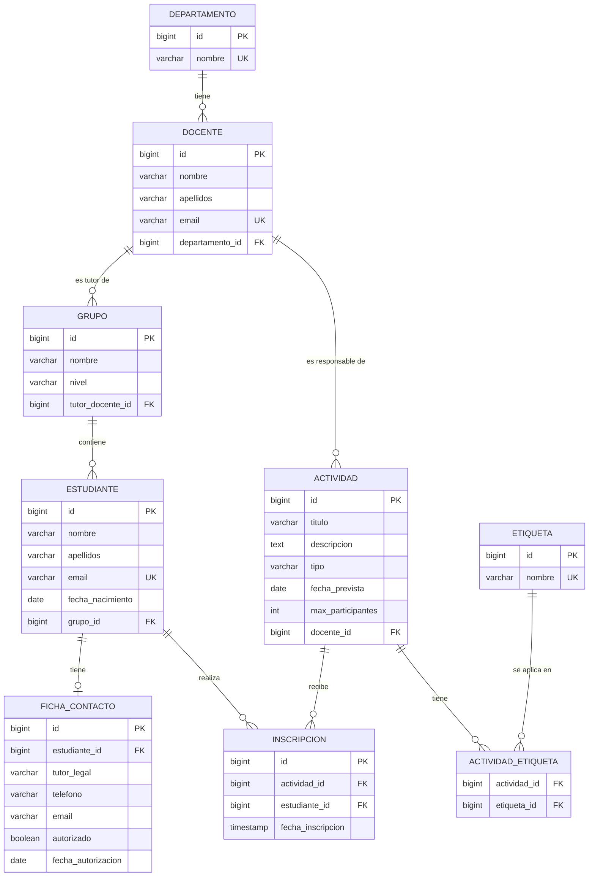

# Modelo de datos — CampusHub

> Versión inicial del diseño. Puede cambiar durante el desarrollo; los cambios se anotarán al final en "Decisiones que cambiaron".

## 1. Reparto entre PostgreSQL y MongoDB

| Motor | Qué guarda | Por qué |
|---|---|---|
| PostgreSQL | Departamentos, docentes, grupos, estudiantes, fichas de contacto, actividades, inscripciones y etiquetas | Datos con estructura fija, relaciones entre ellos y reglas que la base de datos debe imponer (unicidad, claves foráneas, aforo). |
| MongoDB | Seguimientos de las actividades | Cada tipo de actividad guarda datos distintos y pueden aparecer tipos nuevos sin cambiar el esquema. |

## 2. Diagrama relacional (PostgreSQL)



## 3. Tablas, restricciones e índices

| Tabla | Qué guarda | Restricciones principales |
|---|---|---|
| `departamento` | Departamentos del centro | `nombre` único y obligatorio |
| `docente` | Docentes | `email` único; `departamento_id` obligatorio (clave foránea) |
| `grupo` | Grupos de estudiantes | `tutor_docente_id` clave foránea a `docente` |
| `estudiante` | Estudiantes | `email` único; `grupo_id` clave foránea; fecha de nacimiento anterior a hoy |
| `ficha_contacto` | Datos del tutor legal | `estudiante_id` único (máximo una ficha) y obligatorio (no existe sin estudiante) |
| `actividad` | Actividades | `max_participantes` mayor que 0; `docente_id` obligatorio; `descripcion` como texto largo |
| `inscripcion` | Inscripción de un estudiante a una actividad | Pareja (`actividad_id`, `estudiante_id`) única; guarda la fecha de inscripción |
| `etiqueta` | Etiquetas o competencias | `nombre` único |
| `actividad_etiqueta` | Une actividades con etiquetas (muchos a muchos) | Clave primaria compuesta (`actividad_id`, `etiqueta_id`) |

### Índices previstos

- Los campos `UNIQUE` (emails, nombres, parejas) crean su índice automáticamente.
- `estudiante.grupo_id`, `docente.departamento_id` y `actividad.docente_id`: para consultar por clave foránea.
- `inscripcion.estudiante_id`: para el historial de un estudiante (RF08).
- `actividad_etiqueta.etiqueta_id`: para consultar las actividades de una etiqueta (RF10).

### Longitudes propuestas (a revisar)

| Campo | Longitud |
|---|---|
| nombre de persona | 100 |
| apellidos | 150 |
| email | 255 |
| título de actividad | 150 |
| nombre de departamento | 100 |
| nombre de etiqueta | 50 |
| descripción de actividad | texto largo (`TEXT`) |

### Borrado (propuesta)

La API no ofrece operaciones de borrado, así que se propone que las claves foráneas **impidan** borrar un registro que tenga datos relacionados (por ejemplo, un docente con actividades), para no dejar referencias rotas.

## 4. MongoDB: colección `seguimientos`

Un documento por cada registro de seguimiento de una actividad:

```json
{
  "_id": "ObjectId",
  "actividadId": 10,
  "tipo": "VISITA",
  "datos": { "empresa": "Acme", "observaciones": ["aprendizaje", "visita"] },
  "creadoEn": "2026-11-12T12:00:00Z"
}
```

- `datos` es un objeto libre: se guarda tal cual llega, así cada tipo de seguimiento puede tener su estructura y aparecer tipos nuevos sin tocar nada.
- Índice sobre (`actividadId`, `creadoEn`): para recuperar los seguimientos de una actividad ordenados por fecha.
- Validación mínima: `actividadId`, `tipo` y `creadoEn` obligatorios y con tipo correcto; `datos` de tipo objeto sin fijar sus campos.

## 5. Riesgo de usar dos motores

La actividad vive en PostgreSQL y sus seguimientos en MongoDB, y no hay una transacción que cubra los dos. Si se registra un seguimiento para una actividad que no existe, o se borra la actividad y quedan seguimientos huérfanos, aparece una inconsistencia. Para reducir el riesgo, el servicio comprobará que la actividad existe en PostgreSQL antes de guardar en MongoDB.

## 6. Decisiones que cambiaron

_(Vacío por ahora. Se irá completando durante el desarrollo.)_
